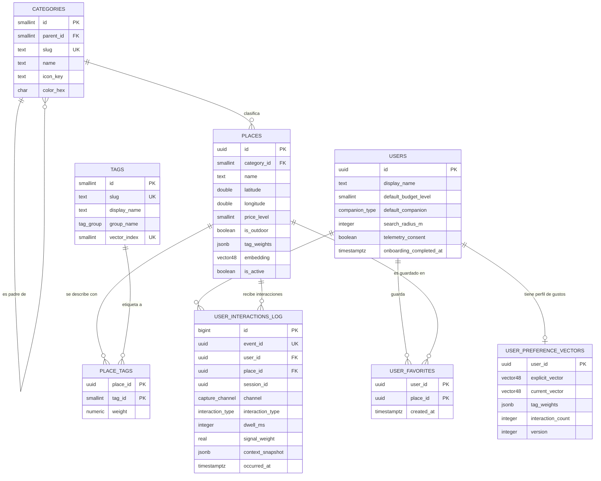

# VibeTrip

> Recomendador móvil contextual de lugares turísticos, gastronomía, actividades y entretenimiento, construido con **Flutter** y **Dart 3**.


[](https://github.com/JanelaCusi-03/VibeTrip/actions/workflows/ci.yml)

---

## Tabla de contenido

1. [Descripción](#descripción)
2. [Propuesta de valor](#propuesta-de-valor)
3. [Método híbrido de captura de gustos](#método-híbrido-de-captura-de-gustos)
4. [Requisitos](#requisitos)
5. [Historias de usuario](#historias-de-usuario)
6. [Contrato de la API REST](#contrato-de-la-api-rest)
7. [Modelo de datos](#modelo-de-datos)
8. [Arquitectura y patrones de diseño](#arquitectura-y-patrones-de-diseño)
9. [Convención de nombres](#convención-de-nombres)
10. [Estrategia de pruebas](#estrategia-de-pruebas)
11. [Control de versiones y CI/CD](#control-de-versiones-y-cicd)
12. [Criterio de optimización](#criterio-de-optimización)
13. [Planificación y equipo](#planificación-y-equipo)
14. [Hoja de ruta de entregables](#hoja-de-ruta-de-entregables)
15. [Estructura del repositorio](#estructura-del-repositorio)
16. [Puesta en marcha](#puesta-en-marcha)
17. [Alineación con la rúbrica](#alineación-con-la-rúbrica)
18. [Licencia](#licencia)

---

## Descripción

**VibeTrip** es una aplicación móvil multiplataforma (Android e iOS) que recomienda de forma inteligente:

- Lugares turísticos y culturales
- Restaurantes y cafeterías
- Actividades al aire libre o recreativas
- Espacios de distracción, vida nocturna y entretenimiento

El proyecto se desarrolla para el curso universitario de **Desarrollo de Software**, bajo los estándares **ISO/IEC/IEEE 29148** (requisitos) e **ISO/IEC 25010** (calidad), con **Clean Architecture** y metodología ágil **Scrum**.

## Propuesta de valor

Las recomendaciones se adaptan dinámicamente a los **gustos**, el **presupuesto** y el **contexto** del usuario. El núcleo investigativo del proyecto es el **método de captura de preferencias** y el **motor de recomendación híbrido** que se alimenta de él.

---

## Método híbrido de captura de gustos

Todo el sistema opera sobre un **espacio de 48 etiquetas** (6 grupos de 8), de modo que lugares y usuarios son vectores comparables.

| Grupo | Índices | Etiquetas |
|---|---|---|
| `ambiente` | 0-7 | tranquilo, animado, romantico, familiar, bohemio, elegante, casual, vista_panoramica |
| `actividad` | 8-15 | aire_libre, aventura, cultural, historico, naturaleza, deportivo, relajante, fotografico |
| `gastronomia` | 16-23 | comida_local, comida_internacional, vegetariano, cafeteria, postres, street_food, fine_dining, bebidas_artesanales |
| `social_nocturno` | 24-31 | vida_nocturna, musica_en_vivo, bar, discoteca, karaoke, juegos, eventos, terraza |
| `perfil_contexto` | 32-39 | economico, premium, para_grupos, para_parejas, solo_friendly, pet_friendly, accesible, wifi_trabajo |
| `experiencia` | 40-47 | artesania, arte, museo, arquitectura, tradicion_local, mistico, compras, mercado |

### 1. Captura explícita gamificada (Cold Start, meta ≤ 45 s)

| Paso | Mecánica | Duración |
|---|---|---|
| A. Selector de *Vibes* | Hasta 3 chips: Relax, Aventura, Cultura, Foodie, Fiesta, Romántico, Naturaleza, Familia | 8 s |
| B. Deck *Swipe* | 12 cartas: derecha (+1), izquierda (−1), arriba (+2) | 24 s |
| C. Dilemas A/B | 3 pares de fotos, un toque por par | 9 s |
| D. Presupuesto y compañía | Slider de 4 niveles y 4 íconos | 4 s |

Vector inicial:

```
u(0) = normalizar( 0.30·p̂ + 0.50·ŝ + 0.20·d̂ )
```

donde `p` es el prior de vibes, `s` la señal de swipes y `d` el contraste A/B (cada uno normalizado en L2).

### 2. Captura implícita (telemetría)

| Señal | Peso (`signal_weight`) |
|---|---|
| `impression_skip` | −0.05 |
| `view_detail` | +0.25 |
| `dwell` | 0 a +0.60 (saturación exponencial) |
| `photo_expand` | +0.35 |
| `directions_click` | +0.90 |
| `share` | +0.80 |
| `favorite_add` | +1.00 |
| `favorite_remove` | −0.50 |
| `discard` | −1.00 |

Ponderación del *dwell time* (`t_min = 2000 ms`, `w_max = 0.60`, `τ = 6000 ms`):

```
w_dwell(t) = 0                                   si t < t_min
w_dwell(t) = w_max · (1 − e^(−(t − t_min)/τ))    si t ≥ t_min
```

Reglas de robustez:

- El cronómetro corre solo con ≥ 50 % de la tarjeta visible y la app en primer plano.
- Tope de ±1.5 por (usuario, lugar, sesión).
- Olvido temporal con vida media de 30 días: `w_ef = w · 2^(−Δt/30)`.
- Cola local en SQLite y envío por lotes con `event_id` (UUID v4) como **clave de idempotencia**.
- Sin `telemetry_consent = true` solo se procesan eventos explícitos.

### 3. Captura contextual en tiempo real

El contexto **no se guarda en el vector de gustos**: modula el puntaje al consultar y se almacena como *snapshot* en el log.

| Variable | Fuente | Fallback |
|---|---|---|
| Ubicación | `geolocator` | Última posición conocida, luego zona manual |
| Franja horaria | Reloj del dispositivo | Siempre disponible |
| Clima | Open-Meteo (caché 30 min) | `unknown` (efecto neutro) |
| Presupuesto | Control del usuario (`price_level` 1-4) | `default_budget_level` |
| Compañía | `solo`, `couple`, `friends`, `family` | `default_companion` |

---

## Requisitos

### Funcionales (prioridad MoSCoW)

| ID | Requerimiento | Prio. |
|---|---|---|
| RF-01 | Autenticación por correo y Google (Supabase Auth) | M |
| RF-02 | Onboarding gamificado en ≤ 45 s con opción de saltar | M |
| RF-03 | Generar y persistir el vector inicial de preferencias | M |
| RF-04 | Registrar señales implícitas | M |
| RF-05 | Capturar contexto: GPS, hora, clima, presupuesto y compañía | M |
| RF-06 | Filtros rápidos: Solo, Con amigos, Económico, Cerca de mí | M |
| RF-07 | Feed ordenado por `matchScore` (0-100 %) | M |
| RF-08 | Explicación textual de cada recomendación | M |
| RF-09 | Actualización dinámica del vector tras cada interacción | M |
| RF-10 | Pantalla de detalle del lugar | M |
| RF-11 | Agregar y quitar favoritos | S |
| RF-12 | Botón «No me interesa» con efecto inmediato | S |
| RF-13 | Mapa interactivo con pines por categoría | S |
| RF-14 | «Cómo llegar» mediante deep link | S |
| RF-15 | Modo sin conexión: caché y cola de eventos | M |
| RF-16 | Privacidad: consentimiento, exportar y eliminar datos | M |
| RF-17 | Reiniciar o reajustar gustos | C |

### No funcionales (medibles)

| ID | Atributo | Requisito | Verificación |
|---|---|---|---|
| RNF-01 | Eficiencia | Ranking de 500 candidatos | p95 ≤ 150 ms |
| RNF-02 | Eficiencia | Arranque en frío | ≤ 3 s al primer feed |
| RNF-03 | Eficiencia | Fluidez | ≥ 55 fps, < 1 % de jank |
| RNF-04 | Usabilidad | Onboarding | ≤ 45 s (mediana, 5 usuarios) |
| RNF-05 | Fiabilidad | Sin red | Caché de hasta 24 h |
| RNF-06 | Fiabilidad | Telemetría | Entrega ≥ 99 %, cero duplicados |
| RNF-07 | Seguridad | Aislamiento | RLS en todas las tablas de usuario |
| RNF-08 | Seguridad | Transporte | TLS ≥ 1.2, JWT ≤ 1 h |
| RNF-09 | Privacidad | Consentimiento | Telemetría implícita desactivada por defecto |
| RNF-10 | Mantenibilidad | Estructura | Clean Architecture, complejidad ciclomática ≤ 10 |
| RNF-11 | Mantenibilidad | Calidad estática | `flutter analyze` sin advertencias |
| RNF-12 | Testabilidad | Cobertura | **≥ 90 %** en dominio y aplicación |
| RNF-13 | Accesibilidad | WCAG 2.1 AA | Áreas táctiles ≥ 48 dp |
| RNF-14 | Portabilidad | Plataformas | Android 8+ (API 26) e iOS 13+ |

---

## Historias de usuario

| ID | Historia | Prio. | Puntos | Trazabilidad |
|---|---|---|---|---|
| HU-01 | Onboarding rápido de gustos (Cold Start) | Must | 8 | RF-02, RF-03, RF-17 |
| HU-02 | Feed contextual con filtros rápidos | Must | 13 | RF-05, RF-06, RF-07 |
| HU-03 | Aprendizaje implícito de mis gustos | Must | 13 | RF-04, RF-09 |
| HU-04 | Entender y corregir las recomendaciones | Must | 5 | RF-08, RF-10, RF-11, RF-12 |
| HU-05 | Uso con mala conexión | Must | 8 | RF-15, RNF-05, RNF-06 |

Ejemplo de criterio de aceptación (Gherkin):

```gherkin
# language: es
Característica: Onboarding gamificado de preferencias

  Escenario: Completar el onboarding y generar el vector inicial
    Dado que soy un usuario autenticado sin vector de preferencias
    Cuando elijo 2 vibes, califico 12 cartas y respondo 3 dilemas A/B
    Entonces el sistema guarda un vector inicial normalizado de dimensión 48
    Y registra la fecha en "onboarding_completed_at"
    Y me muestra el feed personalizado
```

---

## Contrato de la API REST

Implementación con **PostgREST** (Supabase) para el CRUD y **Edge Functions** para las reglas de negocio. Los errores siguen el formato *Problem Details* (RFC 9457).

| Verbo | Ruta | Idempotente | Éxito | Errores |
|---|---|---|---|---|
| GET | `/v1/places?lat&lon&radius_m&category&limit&cursor` | Sí | 200 | 400, 401, 500 |
| GET | `/v1/places/{placeId}` | Sí | 200 | 401, 404, 500 |
| GET | `/v1/me/preferences` | Sí | 200 | 401, 404, 500 |
| PUT | `/v1/me/preferences` (`If-Match: <version>`) | Sí | 200, 201 | 400, 401, 412, 500 |
| POST | `/v1/me/interactions` (lote con `event_id`) | Sí, por clave | 201, 200 | 400, 401, 500 |
| PUT | `/v1/me/favorites/{placeId}` | Sí | 201, 204 | 401, 404, 500 |
| DELETE | `/v1/me/favorites/{placeId}` | Sí | 204 | 401, 404, 500 |
| DELETE | `/v1/me` | Sí | 204 | 401, 500 |

---

## Modelo de datos

Base de datos **PostgreSQL (Supabase)** con las extensiones **pgvector** (vectores de 48 dimensiones) y **PostGIS** (geolocalización).

| Tabla | Propósito |
|---|---|
| `users` | Perfil, defaults de contexto y consentimiento |
| `categories` | Clasificación jerárquica con ícono y color del pin |
| `tags` | Catálogo de las 48 dimensiones |
| `places` | Lugares con ubicación, contexto y embedding |
| `place_tags` | Peso de cada etiqueta en cada lugar (fuente de verdad) |
| `user_preference_vectors` | Vector de gustos versionado (concurrencia optimista) |
| `user_interactions_log` | Eventos explícitos e implícitos (solo se agregan filas) |
| `user_favorites` | Lugares guardados |

El esquema completo está en [`/supabase/migrations`](./supabase/migrations) y la seguridad se garantiza con **Row Level Security** en todas las tablas.



---

## Arquitectura y patrones de diseño

Clean Architecture con organización *feature-first* (capas Presentation, Domain y Data) y estado reactivo con Riverpod.

| Patrón | Tipo | Aplicación | Justificación |
|---|---|---|---|
| Repository | Arquitectónico | `PlaceRepository`, `UserProfileRepository` | Aísla el dominio de Supabase y de la caché |
| Decorator | GoF | `CachedPlaceRepository` | Agrega Offline-First sin modificar el original |
| Strategy | GoF | `ScoringStrategy` por factor | Cada factor se cambia y prueba por separado |
| Observer / Pub-Sub | Arquitectónico | Riverpod y *stream* de telemetría | Desacopla la UI del tracker |
| Factory | GoF | `InteractionEvent.fromViewDuration(...)` | Centraliza validación y cálculo de pesos |
| Dependency Injection | Implementación | Providers de Riverpod | Facilita pruebas con *fakes* y *mocks* |

## Convención de nombres

Los nombres deben revelar intención y llevar unidades.

| Evitar | Usar |
|---|---|
| `list1`, `x`, `d` | `candidatePlaces`, `userVector`, `distanceInMeters` |
| `calc()` | `computeHaversineDistanceInMeters()` |
| `flag` | `hasTelemetryConsent` |
| `data`, `info` | `placeSnapshot`, `contextSnapshot` |
| `w` | `dwellSignalWeight` |

Reglas: unidades en el nombre (`_ms`, `_m`, `Meters`), clases como sustantivos, métodos como verbos, booleanos con `is/has/can` y archivos en `snake_case`.

---

## Estrategia de pruebas

| Nivel | Herramienta | Alcance |
|---|---|---|
| Unitarias | `flutter_test`, `mocktail` | Dominio, motor, ponderaciones (≥ 90 %) |
| Widget | `flutter_test` | Onboarding, tarjeta de lugar, filtros |
| Integración | `integration_test` | Flujo onboarding a feed |
| Contrato API | Supabase local | Verbos y códigos HTTP |

```bash
flutter test --coverage
```

El pipeline de CI **falla si la cobertura baja de 90 %**.

## Control de versiones y CI/CD

- **Flujo:** GitHub Flow. `main` protegida (PR obligatorio, 1 aprobación y CI verde).
- **Ramas:** `feat/`, `fix/`, `docs/`.
- **Commits:** [Conventional Commits](https://www.conventionalcommits.org/es/), por ejemplo `feat(onboarding): add swipe deck`.
- **CI/CD:** GitHub Actions ejecuta formato, análisis estático, pruebas con *quality gate* de cobertura y *build* del APK como artefacto.

El workflow está en [`.github/workflows/ci.yml`](./.github/workflows/ci.yml).

## Criterio de optimización

La optimización es reactiva y basada en datos:

1. Primero la funcionalidad (criterios Gherkin cumplidos).
2. Medir con el Profiler contra RNF-01 a RNF-03.
3. Optimizar solo si un requisito falla, guiándose por el *flame chart*.
4. Documentar cada mejora en `docs/perf/` con medición antes y después.

## Planificación y equipo

| Rol | Responsabilidad | Integrante |
|---|---|---|
| Product Owner | Prioriza el backlog y valida criterios de aceptación | Angel Ismael Alvarez Catunta (221945) |
| Coach / Scrum Master | Facilita ceremonias y vela por el DoD | Ibeth Janela del Pilar Cusi Diaz (210924) |
| Mobile Lead | UI, estado y arquitectura Flutter | Angel Ismael Alvarez Catunta (221945) |
| Data/Backend Engineer | Esquema SQL, API y motor de recomendación | Ibeth Janela del Pilar Cusi Diaz (210924) |

**Sprints de 2 semanas:** S1 modelo de datos y CI · S2 dominio y datos · S3 motor y telemetría · S4 UI y mapa · S5 QA, optimización y sustentación.

**Definición de Hecho (DoD):** revisión por un par, pruebas en verde, cobertura del módulo ≥ 90 %, `flutter analyze` limpio y criterios Gherkin demostrados.

---

## Hoja de ruta de entregables

| # | Entregable | Estado |
|---|---|---|
| 1 | Ingeniería de requisitos, método de captura y modelo de datos | ✅ Completado |
| 2 | Diseño matemático del motor y arquitectura Flutter | ✅ Completado ([docs](./docs/entregable-2/ENTREGABLE_2.md)) |
| 3 | Capa de dominio, datos y modelos en Dart | ✅ Completado ([docs](./docs/entregable-3/ENTREGABLE_3.md)) |
| 4 | Motor de recomendación y telemetría | ✅ Completado ([docs](./docs/entregable-4/ENTREGABLE_4.md)) |
| 5 | UI/UX, geolocalización y pruebas (QA) | ✅ Completado ([docs](./docs/entregable-5/ENTREGABLE_5.md)) |

## Estructura del repositorio

```
VibeTrip/
├── .github/workflows/ci.yml        # CI: formato, análisis, pruebas, gate de cobertura, APK
├── android/ · ios/                 # Plataformas (permisos de ubicación e internet)
├── assets/seed/places.json         # 18 lugares de Cusco (modo local)
├── docs/
│   ├── entregable-1/ … entregable-5/
│   ├── metodologia-kanban/         # Guía del tablero Kanban del proyecto
│   └── perf/                       # Mediciones de rendimiento
├── lib/
│   ├── core/                       # Dominio compartido (vectores, Haversine), DI, router, tema
│   └── features/
│       ├── places/                 # Lugares, caché offline, detalle y mapa
│       ├── profile/                # Perfil, onboarding y privacidad
│       ├── recommendation/         # Motor, contexto (GPS, clima) y feed
│       └── telemetry/              # Eventos, aprendizaje del vector y tracker
├── supabase/                       # Migraciones, seed.sql y seed_places.sql
├── test/                           # Unitarias, widget y evaluación (119 pruebas)
└── tool/                           # check_coverage.dart, generate_seed_sql.dart
```

## Puesta en marcha

**Requisitos previos:** Flutter estable (probado con 3.47.6 / Dart 3.13) y un celular Android o emulador.

```bash
git clone https://github.com/JanelaCusi-03/VibeTrip.git
cd VibeTrip
flutter pub get
flutter analyze
flutter test --coverage
flutter run
```

Sin configuración extra la app funciona en **modo local** con los lugares de `assets/seed/places.json`. Si el GPS está lejos de Cusco, usa el ícono de ubicación de la barra superior para cambiar a la zona manual «Centro de Cusco».

Para usar Supabase (requiere las extensiones `vector` y `postgis`):

```bash
supabase db reset                              # migraciones + seed.sql
psql "$DATABASE_URL" -f supabase/seed_places.sql
flutter run --dart-define=SUPABASE_URL=https://<proyecto>.supabase.co             --dart-define=SUPABASE_PUBLISHABLE_KEY=<clave>
```

Métricas para la sustentación (Precision@K y latencia):

```bash
flutter test test/evaluation --reporter expanded
```

## Alineación con la rúbrica

| Criterio | Cómo se cumple |
|---|---|
| Nombres reveladores | Convención obligatoria con unidades y prefijos |
| Patrones de diseño | Catálogo GoF y arquitectónico con justificación |
| Pruebas automatizadas | Cobertura ≥ 90 % con *quality gate* en CI |
| Control de versiones y entrega | GitHub Flow, ramas protegidas y GitHub Actions |
| Planificación y equipo | Roles, *story map* e historias de usuario |
| Criterio de optimización | Presupuestos medibles y optimización con Profiler |
| Integración API | Verbos por idempotencia y códigos HTTP precisos |

## Licencia

Proyecto académico. Define aquí la licencia (por ejemplo, MIT) antes de hacerlo público.
