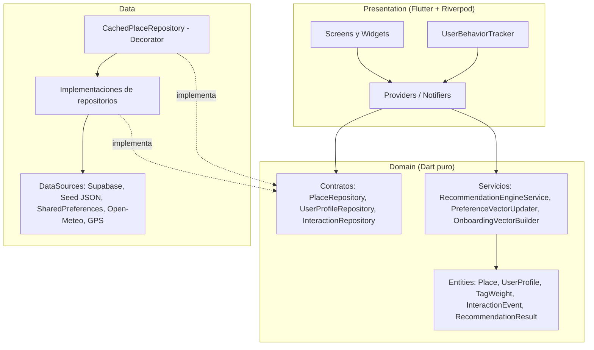
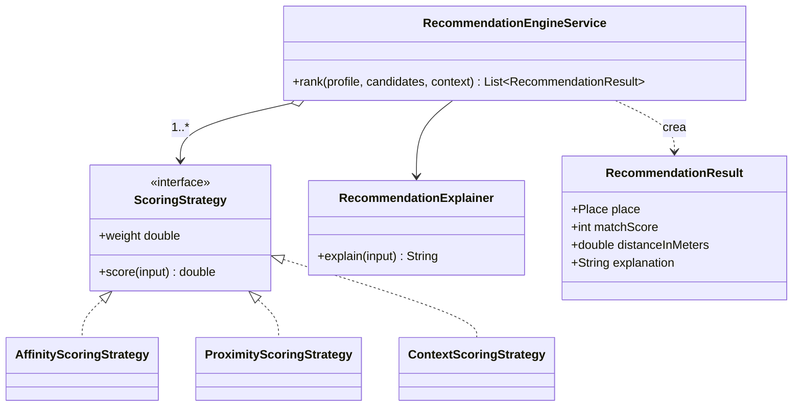
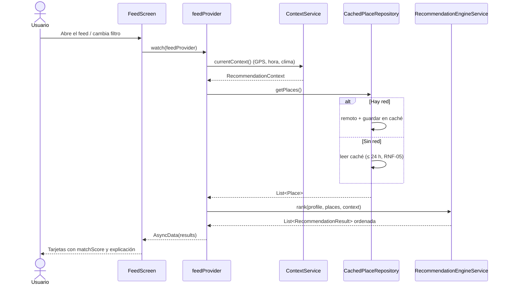
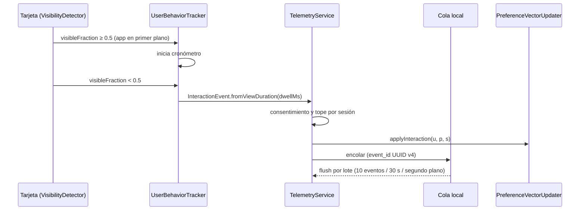

# Entregable 2: Diseño Matemático del Motor de Recomendación y Arquitectura Flutter

**Proyecto:** VibeTrip
**Estándares:** ISO/IEC/IEEE 29148, ISO/IEC 25010, Clean Architecture (Feature-First), Scrum
**Trazabilidad:** RF-03, RF-05 a RF-09, RF-12, RNF-01, RNF-10

> Las fórmulas de este documento son el **contrato** del código: cada constante tiene el mismo nombre y valor en `lib/` y se valida con pruebas unitarias (ver sección 7).

---

## 1. Notación

| Símbolo | Significado | Dominio |
|---|---|---|
| `d` | Dimensión del espacio de etiquetas | `d = 48` |
| `p ∈ ℝᵈ` | Vector de un lugar (`places.embedding`, derivado de `place_tags`) | `pᵢ ∈ [0, 1]` |
| `u ∈ ℝᵈ` | Vector de gustos del usuario (`current_vector`) | `uᵢ ∈ [−1, 1]` |
| `u₀` | Vector explícito del onboarding (`explicit_vector`) | `[−1, 1]ᵈ` |
| `x̂` | Normalización L2: `x / ‖x‖₂` (si `‖x‖₂ = 0`, `x̂ = 0`) | — |
| `clip(x)` | Recorte componente a componente a `[−1, 1]` | — |
| `r` | Radio de búsqueda del usuario (`search_radius_m`) | 500 a 50 000 m |
| `κ` | Contexto: franja horaria, clima, presupuesto, compañía | ver E1 §1.4 |

Un valor negativo en `uᵢ` representa **rechazo** de la etiqueta `i`; por eso `u` vive en `[−1, 1]` y `p` en `[0, 1]`.

---

## 2. Construcción del vector inicial (Cold Start)

Se mantiene la fórmula del Entregable 1:

```
p_v = (1/|V|) · Σ_{v ∈ V} π_v                  prior de vibes (|V| ≤ 3)
s   = Σ_{i=1..12} rᵢ · eᵢ,   rᵢ ∈ {−1, +1, +2}   swipes
δ   = Σ_{j=1..3} (e_Aj − e_Bj)                  contraste A/B (A = elegida)

u₀ = clip( normalizar( α·p̂_v + β·ŝ + γ·δ̂ ) )     α = 0.30, β = 0.50, γ = 0.20
```

- `π_v` es un vector disperso por vibe (por ejemplo `Relax → tranquilo 1.0, relajante 1.0, naturaleza 0.5, cafeteria 0.4`).
- `eᵢ` es el vector de la carta `i` del deck; cada carta tiene 3 a 5 etiquetas activas.
- Si el usuario **salta** el onboarding (RF-02), `u₀ = normalizar(p̂_v)` y, si tampoco eligió vibes, `u₀ = 0` (el ranking queda dominado por proximidad y contexto, equivalente a "popular cerca de ti").

---

## 3. Función de puntuación híbrida

Para cada lugar candidato `p` con distancia `dist` al usuario:

```
S(u, p, κ) = w_A · A(u, p) + w_G · G(dist) + w_C · C(p, κ)

w_A = 0.60   (afinidad de gustos)
w_G = 0.20   (proximidad geográfica)
w_C = 0.20   (ajuste al contexto)

matchScore = round(100 · S) ∈ [0, 100]
```

Cada factor está en `[0, 1]`, de modo que `S ∈ [0, 1]`. Cada factor se implementa como una **estrategia** independiente (patrón Strategy): se puede recalibrar o reemplazar sin tocar el motor.

### 3.1 Afinidad: similitud del coseno

```
cos(u, p) = (u · p) / (‖u‖₂ · ‖p‖₂)          (0 si algún vector es nulo)
A(u, p)   = max(0, cos(u, p))
```

Se usa `max(0, ·)` en lugar de `(1 + cos)/2` para que un lugar **ortogonal** a los gustos (coseno 0) no reciba un 50 % de afinidad "regalado": mejora el contraste del ranking.

### 3.2 Proximidad: Haversine con decaimiento exponencial

Distancia geodésica entre el usuario `(φ₁, λ₁)` y el lugar `(φ₂, λ₂)`, en radianes:

```
a    = sin²(Δφ/2) + cos φ₁ · cos φ₂ · sin²(Δλ/2)
dist = 2R · atan2(√a, √(1 − a))               R = 6 371 008.8 m (radio medio IUGG)
```

Decaimiento con vida media igual a la mitad del radio:

```
G(dist) = 2^(−dist / d½),   d½ = r / 2
```

Así un lugar a `r/2` vale 0.5 y uno en el borde del radio vale 0.25. **Filtro duro:** si `dist > r` el lugar no es candidato (RF-06 «Cerca de mí» usa `r = 1000 m`).

### 3.3 Contexto: penalización y bonificación

```
C(p, κ) = (T + B + K + W) / 4
```

| Sub-factor | Regla | Valor |
|---|---|---|
| **T** franja horaria | franja actual ∈ `best_time_buckets` | 1.0 |
| | `best_time_buckets` vacío (sin dato) | 0.6 |
| | en otro caso | 0.2 |
| **B** presupuesto | `price_level ≤ budget` | 1.0 |
| | `price_level > budget` | `2^−(price_level − budget)` |
| **K** compañía | compañía ∈ `companion_fit` | 1.0 |
| | `companion_fit` vacío | 0.6 |
| | en otro caso | 0.3 |
| **W** clima (al aire libre) | clear 1.0 · cloudy 0.8 · hot 0.7 · cold 0.4 · rain 0.2 · unknown 0.8 | |
| **W** clima (bajo techo) | rain 1.0 · cold 1.0 · resto 0.8 | |

Franjas (E1 §1.4): `morning` 06-11 h, `afternoon` 12-17 h, `evening` 18-21 h, `night` 22-05 h.

### 3.4 Ejemplo numérico (3 dimensiones para ilustrar)

Usuario `u = (tranquilo 0.8, animado 0.0, aire_libre 0.6)`, radio 3000 m, contexto: `evening`, presupuesto 2, pareja, cielo despejado.

| | Mirador | Discoteca |
|---|---|---|
| `p` | (0.9, 0.1, 1.0) | (0.0, 1.0, 0.0) |
| `cos(u,p)` | 1.32 / (1 · 1.3491) = **0.9784** | 0 |
| distancia | 1200 m → `G = 2^(−0.8)` = **0.5743** | 300 m → `G = 2^(−0.2)` = **0.8706** |
| T, B, K, W | 1, 1, 1, 1 (exterior despejado) | 0.2, 1, 0.3, 0.8 |
| `C` | **1.000** | **0.575** |
| `S` | 0.6·0.9784 + 0.2·0.5743 + 0.2·1 = **0.9019** | 0 + 0.2·0.8706 + 0.2·0.575 = **0.2891** |
| **matchScore** | **90 %** | **29 %** |

Aunque la discoteca está más cerca, el mirador gana por afinidad y contexto, que es el comportamiento esperado.

### 3.5 Explicación de la recomendación (RF-08)

Contribución de cada etiqueta al producto punto: `cᵢ = uᵢ · pᵢ`. Se toman las **dos** etiquetas con mayor `cᵢ ≥ 0.05` y se agrega el motivo contextual más fuerte:

```
"Recomendado porque te gusta lo tranquilo y aire libre · a 1.2 km · ideal para esta hora"
```

Si ninguna etiqueta supera el umbral, la explicación se basa solo en el contexto ("Cerca de ti y dentro de tu presupuesto").

### 3.6 Exclusiones

- Lugares descartados con «No me interesa» (RF-12): se excluyen del feed de inmediato.
- Lugares inactivos (`is_active = false`).
- Filtro rápido «Económico» (RF-06): `price_level ≤ 2`.

---

## 4. Actualización dinámica del vector (RF-09)

### 4.1 Peso de la señal

El peso `s ∈ [−1, 1]` sale de la tabla del Entregable 1 §1.3. Para `dwell`:

```
s_dwell(t) = 0                                  si t < 2000 ms
s_dwell(t) = 0.60 · (1 − e^(−(t − 2000)/6000))  si t ≥ 2000 ms
```

Ejemplo: `t = 8000 ms → 0.60 · (1 − e^(−1)) = 0.379`.

### 4.2 Regla de aprendizaje en línea

```
u ← clip( u + η · s · p ),      η = 0.15 (tasa de aprendizaje)
```

Interpretación: una señal positiva acerca `u` hacia las etiquetas del lugar; una negativa lo aleja. Con `favorite_add` (`s = 1`) sobre el mirador del ejemplo: `tranquilo 0.8 → 0.935`, `aire_libre 0.6 → 0.75`.

### 4.3 Tope por sesión

Para cada `(usuario, lugar, sesión)` se acumula `Σs`. La señal aplicada se recorta para que `|Σs| ≤ 1.5`. Evita que muchos eventos repetidos sobre el mismo lugar sesguen el vector.

### 4.4 Olvido temporal

La deriva aprendida `Δ = u − u₀` se atenúa con vida media `H = 30` días:

```
Δ ← Δ · 2^(−Δt / H)
u ← clip(u₀ + Δ)
```

Se aplica al cargar el perfil, usando `last_decay_applied_at`. Así los gustos explícitos son estables y los implícitos se actualizan con el uso reciente.

### 4.5 Consentimiento (RF-16, RNF-09)

Si `telemetry_consent = false`, solo se aplican eventos explícitos (`favorite_add`, `favorite_remove`, `discard`); los implícitos (`dwell`, `view_detail`, etc.) se descartan en el cliente y no se encolan.

---

## 5. Arquitectura de software

### 5.1 Clean Architecture Feature-First

Cada *feature* tiene tres capas. La regla de dependencia apunta hacia adentro: **Presentation → Domain ← Data**. El dominio es Dart puro (sin Flutter ni Supabase) y es lo que mide el *quality gate* de cobertura.



### 5.2 Diagrama de clases del motor



### 5.3 Secuencia: obtener el feed



### 5.4 Secuencia: telemetría implícita



### 5.5 Gestión de estado con Riverpod

| Provider | Tipo | Responsabilidad |
|---|---|---|
| `sharedPreferencesProvider` | `Provider` (override en `main`) | Instancia única de almacenamiento local |
| `placeRepositoryProvider` | `Provider` | Inyecta `CachedPlaceRepository` (Supabase o seed) |
| `userProfileProvider` | `AsyncNotifierProvider` | Perfil y vector; aplica olvido temporal al cargar |
| `recommendationContextProvider` | `FutureProvider` | Contexto actual (GPS, hora, clima) |
| `quickFilterProvider` | `NotifierProvider` | Filtro rápido seleccionado |
| `feedProvider` | `FutureProvider` | Ranking ordenado (depende de los anteriores) |
| `telemetryServiceProvider` | `Provider` | Servicio de telemetría con su cola |

Los providers son la **inyección de dependencias**: en pruebas se reemplazan con `ProviderScope(overrides: [...])` por *fakes*.

---

## 6. Árbol de directorios

```
lib/
├── main.dart                          # Arranque: SharedPreferences, Supabase opcional, ProviderScope
├── app.dart                           # MaterialApp.router + tema
├── core/
│   ├── config/app_config.dart         # SUPABASE_URL y SUPABASE_PUBLISHABLE_KEY vía --dart-define
│   ├── domain/                        # Dart puro compartido
│   │   ├── tag_catalog.dart           # 48 etiquetas, 6 grupos (espejo de la tabla tags)
│   │   ├── tag_vector.dart            # Vector inmutable de 48 dimensiones
│   │   ├── vector_math.dart           # Coseno, normalización L2, clip
│   │   ├── geo_distance.dart          # Haversine
│   │   └── context_types.dart         # TimeBucket, CompanionType, WeatherCondition
│   ├── providers/core_providers.dart
│   ├── router/app_router.dart
│   └── theme/app_theme.dart
└── features/
    ├── places/
    │   ├── domain/   (entities/place.dart, repositories/place_repository.dart)
    │   ├── data/     (datasources/, models/place_json_mapper.dart, repositories/cached_place_repository.dart)
    │   └── presentation/ (place_detail_screen.dart, map_screen.dart)
    ├── profile/
    │   ├── domain/   (entities/user_profile.dart, onboarding_catalog.dart, services/onboarding_vector_builder.dart)
    │   ├── data/     (local_user_profile_repository.dart)
    │   └── presentation/ (onboarding_screen.dart y pasos)
    ├── recommendation/
    │   ├── domain/   (entities/, services/recommendation_engine_service.dart, scoring/, recommendation_metrics.dart)
    │   ├── data/     (device_context_service.dart, open_meteo_weather_source.dart)
    │   └── presentation/ (feed_screen.dart, place_recommendation_card.dart, quick_filter_bar.dart)
    └── telemetry/
        ├── domain/   (entities/interaction_event.dart, services/signal_weight_policy.dart,
        │              services/preference_vector_updater.dart, services/telemetry_service.dart)
        ├── data/     (local_interaction_queue.dart, supabase_interaction_sender.dart)
        └── presentation/ (user_behavior_tracker.dart)

assets/seed/places.json                # Datos semilla (Entregable 3)
test/                                  # Espejo de lib/ (unit, widget)
tool/check_coverage.dart               # Quality gate de CI
```

---

## 7. Dependencias (`pubspec.yaml`) y justificación

| Paquete | Versión | Uso | Justificación | Alternativa descartada |
|---|---|---|---|---|
| `flutter_riverpod` | ^3.4.3 | Estado e inyección | Seguro en compilación, sin `BuildContext`, *overrides* para pruebas | `provider`, `bloc` (más *boilerplate*) |
| `go_router` | ^18.1.1 | Navegación | Paquete oficial, rutas declarativas y deep links `/places/:placeId` | `Navigator` 1.0 (imperativo) |
| `supabase_flutter` | ^2.18.3 | Backend | Auth, PostgREST y RLS del Entregable 1 | Firebase (sin SQL ni pgvector) |
| `http` | ^1.6.0 | Clima | Una sola API externa (Open-Meteo): no se necesita más | `dio` (interceptores innecesarios aquí) |
| `geolocator` | ^14.1.2 | GPS | Permisos y última posición conocida (fallback E1 §1.4) | `location` (menos mantenido) |
| `flutter_map` | ^8.3.2 | Mapa | OpenStreetMap sin API key ni facturación | `google_maps_flutter` (requiere clave y tarjeta) |
| `latlong2` | ^0.10.1 | Coordenadas | Tipo `LatLng` que exige `flutter_map` | — |
| `shared_preferences` | ^2.5.6 | Caché y cola | Clave-valor suficiente para ≤ 500 lugares y la cola de eventos; se simula con *mock* en pruebas | `sqflite` (ver ADR-01) |
| `uuid` | ^4.6.0 | Idempotencia | `event_id` v4 generado en el cliente | — |
| `url_launcher` | ^6.3.3 | «Cómo llegar» | Deep link a Google Maps / Apple Maps (RF-14) | — |
| `visibility_detector` | ^0.4.0+2 | Dwell time | Entrega el `visibleFraction` de cada tarjeta (regla ≥ 50 %) | Cálculo manual con `ScrollController` |
| `mocktail` (dev) | ^1.0.5 | Pruebas | *Mocks* sin generación de código | `mockito` (requiere `build_runner`) |

### ADR-01: `shared_preferences` en lugar de SQLite para la cola local

- **Contexto:** el Entregable 1 propuso SQLite para la cola de telemetría.
- **Decisión:** usar `shared_preferences` con serialización JSON detrás de una interfaz (`InteractionQueue`).
- **Motivos:** el volumen esperado es pequeño (cola ≤ 200 eventos, caché ≤ 500 lugares); funciona en pruebas unitarias sin binarios nativos; reduce dependencias.
- **Consecuencia:** si la cola supera ~1 MB, se reemplaza la implementación por `sqflite`/`drift` sin tocar el dominio (gracias a la interfaz).

### ADR-02: Modelos inmutables escritos a mano en lugar de `freezed`

- **Decisión:** clases `final` con constructores `const`, `copyWith`, `==`/`hashCode` y *mappers* JSON explícitos en la capa Data.
- **Motivos:** evita `build_runner` y archivos generados en el repositorio y en el CI; Dart 3 (clases `sealed`, *records*, *pattern matching*) cubre lo necesario; el mapeo JSON queda visible para la revisión del docente.

---

## 8. Validación de este entregable

| Elemento | Verificación |
|---|---|
| Coseno, Haversine, normalización, clip | `test/core/domain/vector_math_test.dart`, `geo_distance_test.dart` |
| Ejemplo numérico §3.4 | Se reproduce en las pruebas del motor (Entregable 4) |
| Arquitectura | `flutter analyze` limpio; el dominio no importa `package:flutter` |
| Dependencias | `flutter pub get` y build del APK en CI |
