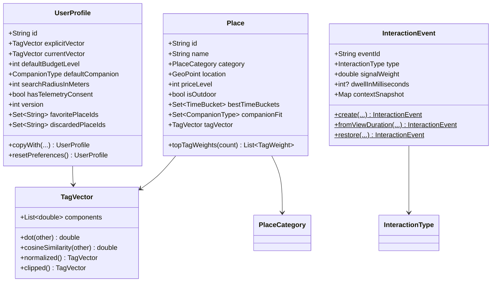
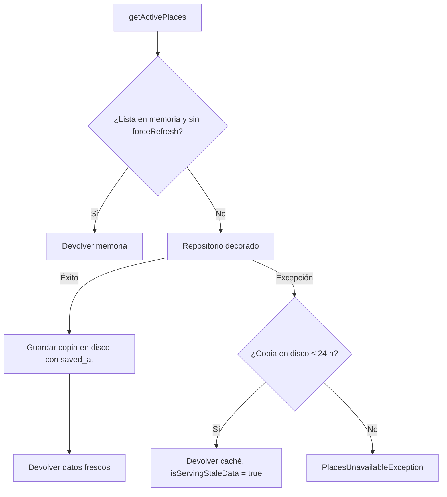

# Entregable 3: Capa de Dominio, Datos y Modelos en Dart

**Proyecto:** VibeTrip
**Trazabilidad:** RF-03, RF-04, RF-11, RF-12, RF-15, RF-16, RF-17, RNF-05, RNF-06, RNF-12
**Patrones:** Repository, Decorator, Factory, Dependency Injection

---

## 1. Modelos inmutables

Todas las entidades son clases con campos `final`, colecciones no modificables (`List.unmodifiable`, `Set.unmodifiable`) y validación en el constructor. No usan Flutter ni Supabase: son Dart puro y están cubiertas por el *quality gate* de dominio (ADR-02: sin `freezed`).

| Entidad | Archivo | Tabla SQL | Invariantes validadas |
|---|---|---|---|
| `TagVector` | `lib/core/domain/tag_vector.dart` | `places.embedding`, `user_preference_vectors.*_vector` | Exactamente 48 componentes |
| `TagWeight` | `lib/core/domain/tag_weight.dart` | `place_tags` | Etiqueta del catálogo |
| `Place` | `lib/features/places/domain/entities/place.dart` | `places` | `price_level` ∈ [1, 4] |
| `PlaceCategory` | `.../places/domain/entities/place_category.dart` | `categories` | Slug existente |
| `UserProfile` | `.../profile/domain/entities/user_profile.dart` | `users` + `user_preference_vectors` | Presupuesto 1-4, radio 500-50 000 m |
| `InteractionEvent` | `.../telemetry/domain/entities/interaction_event.dart` | `user_interactions_log` | Peso en [−1, 1], `dwell` exige duración |
| `RecommendationContext` | `.../recommendation/domain/entities/recommendation_context.dart` | `context_snapshot` (JSONB) | — |
| `RecommendationResult` | `.../recommendation/domain/entities/recommendation_result.dart` | — (salida del motor) | — |



### 1.1 Patrón Factory en `InteractionEvent`

El constructor es privado. Los eventos solo se crean con:

| Factory | Uso | Regla |
|---|---|---|
| `InteractionEvent.create` | Favorito, descarte, «cómo llegar», compartir | Peso = peso base del tipo; prohíbe `dwell` |
| `InteractionEvent.fromViewDuration` | Tarjeta visible un tiempo `t` | `t < 1 s → impression_skip (−0.05)`; si no, `dwell` con `0.60·(1 − e^(−(t−2000)/6000))` |
| `InteractionEvent.restore` | Leer de la cola o del servidor | Revalida rango e invariantes |

La identidad (`==`) es el `event_id`: dos eventos con el mismo UUID son el mismo evento, base de la idempotencia.

---

## 2. Contratos (Repositories)

| Contrato | Métodos | Implementaciones |
|---|---|---|
| `PlaceRepository` | `getActivePlaces({forceRefresh})`, `getPlaceById(id)` | `RemotePlaceRepository`, `CachedPlaceRepository` |
| `UserProfileRepository` | `loadProfile()`, `saveProfile()`, `deleteProfile()` | `LocalUserProfileRepository` |
| `InteractionRepository` | `enqueue()`, `pendingCount()`, `flush()`, `clear()` | `QueuedInteractionRepository` |

## 3. Fuentes de datos (DataSources)

| DataSource | Origen | Cuándo se usa |
|---|---|---|
| `SeedPlaceDataSource` | `assets/seed/places.json` | Modo local (sin `--dart-define` de Supabase) |
| `SupabasePlaceDataSource` | PostgREST `places` + `categories(slug)` | Con Supabase configurado |
| `PlaceLocalCacheDataSource` | `shared_preferences` (`cache.places.v1`) | Respaldo sin conexión |
| `LocalInteractionQueue` | `shared_preferences` (`telemetry.queue.v1`) | Toda la telemetría pasa por aquí |
| `SupabaseInteractionRemoteDataSource` | `upsert` en `user_interactions_log` con `ignoreDuplicates` | Con Supabase configurado |
| `LocalOnlyInteractionRemoteDataSource` | — | Modo local |

## 4. Offline-First

### 4.1 Lugares: `CachedPlaceRepository` (Decorator)



El Decorator envuelve cualquier `PlaceRepository` sin modificarlo (principio abierto/cerrado): el mismo código sirve con el seed o con Supabase.

### 4.2 Telemetría: cola idempotente

1. `enqueue` agrega a la cola local; si el `event_id` ya existe, no hace nada.
2. `flush` toma lotes de 10, los envía y solo entonces los elimina de la cola.
3. Si el envío falla, el lote queda en la cola y se reintenta en el siguiente `flush`.
4. En el servidor, `upsert(onConflict: event_id, ignoreDuplicates: true)` descarta duplicados: un reintento nunca crea filas repetidas (RNF-06).
5. La cola tiene un máximo de 200 eventos; si se excede se descartan los más antiguos.

---

## 5. Datos semilla

Archivo: [`assets/seed/places.json`](../../assets/seed/places.json). Son **18 lugares reales del centro histórico de Cusco** con coordenadas aproximadas. Los pesos de etiquetas los asignó el equipo para las pruebas del motor: no provienen de una fuente externa.

| # | Lugar | Categoría | Precio | Etiquetas principales |
|---|---|---|---|---|
| 1 | Qorikancha | Sitio histórico | 2 | histórico, arquitectura, cultural |
| 2 | Museo de Arte Precolombino | Museo | 2 | museo, arte, cultural |
| 3 | Sacsayhuamán | Sitio histórico | 3 | histórico, aire libre, arquitectura |
| 4 | Mirador de San Cristóbal | Mirador | 1 | vista panorámica, fotográfico, económico |
| 5 | Cristo Blanco | Mirador | 1 | vista panorámica, aire libre, económico |
| 6 | Barrio de San Blas | Sitio histórico | 1 | bohemio, artesanía, arte |
| 7 | Mercado Central de San Pedro | Restaurante | 1 | mercado, económico, comida local |
| 8 | Chicha por Gastón Acurio | Restaurante | 3 | comida local, alta cocina, elegante |
| 9 | Cicciolina | Restaurante | 3 | comida internacional, parejas, romántico |
| 10 | Pachapapa | Restaurante | 2 | comida local, tradición, familiar |
| 11 | Green Point | Restaurante | 1 | vegetariano, casual, ideal para ir solo |
| 12 | Jack's Café | Cafetería | 2 | cafetería, casual, postres |
| 13 | Limbus Restobar | Bar | 3 | vista panorámica, terraza, bar |
| 14 | Ukukus | Bar | 2 | música en vivo, vida nocturna, animado |
| 15 | Mama Africa | Discoteca | 2 | discoteca, vida nocturna, animado |
| 16 | Plaza de Armas del Cusco | Parque | 1 | arquitectura, económico, histórico |
| 17 | Caminata al Templo de la Luna | Aventura | 1 | aire libre, naturaleza, místico |
| 18 | Centro de Textiles Tradicionales | Museo | 1 | artesanía, tradición local, cultural |

El script [`tool/generate_seed_sql.dart`](../../tool/generate_seed_sql.dart) genera [`supabase/seed_places.sql`](../../supabase/seed_places.sql) con los mismos lugares: inserta `places` y `place_tags`, y el trigger del Entregable 1 calcula `embedding` y `tag_weights`.

```bash
dart run tool/generate_seed_sql.dart
```

> **Pendiente de verificar:** el SQL generado aún no se ejecutó contra una instancia de Supabase/PostgreSQL. Hay que probarlo con `supabase db reset` y luego `psql -f supabase/seed_places.sql`.

---

## 6. Pruebas

| Archivo | Qué valida |
|---|---|
| `test/features/domain_entities_test.dart` | Invariantes de entidades, factories de eventos, fórmula de dwell, snapshot de contexto |
| `test/features/places/places_data_test.dart` | Validez del seed (≥ 10 lugares, 4 categorías, pesos en [0, 1], ubicación en Cusco), mapper JSON y los 6 escenarios del Decorator |
| `test/features/profile_and_telemetry_data_test.dart` | Persistencia del perfil, cola idempotente, envío por lotes y reintento ante fallos |

Resultado al cerrar el entregable: **63 pruebas en verde**, cobertura de dominio **99.2 %**, capa de datos **95.1 %**. Las líneas sin cubrir son las llamadas directas a Supabase, que requieren una instancia real (prueba de contrato del Entregable 5).
