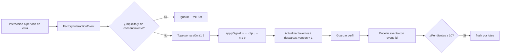

# Entregable 4: Motor de Recomendación y Telemetría en Dart

**Proyecto:** VibeTrip
**Trazabilidad:** RF-02, RF-03, RF-04, RF-07, RF-08, RF-09, RF-11, RF-12, RNF-06, RNF-09
**Patrones:** Strategy, Observer, Factory, Dependency Injection

> Este entregable implementa en código las fórmulas del [Entregable 2](../entregable-2/ENTREGABLE_2.md). Cada constante tiene el mismo valor en el documento y en `lib/`, y las pruebas reproducen los ejemplos numéricos del documento.

---

## 1. `RecommendationEngineService`

Archivo: [`lib/features/recommendation/domain/services/recommendation_engine_service.dart`](../../lib/features/recommendation/domain/services/recommendation_engine_service.dart)

```dart
final List<RecommendationResult> ranking = RecommendationEngineService().rank(
  profile: userProfile,              // vector u, descartes
  candidatePlaces: places,           // lugares candidatos
  context: recommendationContext,    // GPS, hora, clima, presupuesto, compañía
  limit: 20,
);
// ranking.first.matchScore   → 90
// ranking.first.explanation  → "Recomendado porque te gusta: Tranquilo y Aire libre · a 1.2 km · ideal para esta hora"
```

### 1.1 Algoritmo

```
para cada lugar p en candidatos:
    si p inactivo, descartado o precio > tope → omitir
    dist ← Haversine(ubicación, p)        (null si no hay GPS)
    si dist > radio → omitir
    para cada estrategia i: fᵢ ← strategyᵢ.score(u, p, contexto, dist)
    S ← Σ wᵢ · fᵢ / Σ wᵢ
    matchScore ← round(100 · S)
    explicación ← explainer.explain(u, p, contexto, dist)
ordenar por S exacto desc, luego distancia asc, luego nombre
```

**Complejidad:** `O(n · d + n log n)`, con `n` candidatos y `d = 48`. Para `n = 500` son unas 24 000 multiplicaciones más el ordenamiento (la medición contra RNF-01 está en el Entregable 5).

### 1.2 Estrategias (patrón Strategy)

| Clase | `factorName` | Peso | Fórmula |
|---|---|---|---|
| `AffinityScoringStrategy` | `affinity` | 0.60 | `max(0, cos(u, p))` |
| `ProximityScoringStrategy` | `proximity` | 0.20 | `2^(−dist / (r/2))`; 0.5 sin GPS |
| `ContextScoringStrategy` | `context` | 0.20 | `(T + B + K + W) / 4` |

Para agregar un factor (por ejemplo, popularidad) basta con crear otra clase que implemente `ScoringStrategy` y pasarla al constructor: el motor no cambia (principio abierto/cerrado).

### 1.3 Explicación (RF-08)

`RecommendationExplainer` calcula `cᵢ = uᵢ · pᵢ`, toma las 2 etiquetas con `cᵢ ≥ 0.05` y agrega la distancia y un motivo de contexto.

| Caso | Texto generado |
|---|---|
| Afinidad alta, franja coincide | `Recomendado porque te gusta: Tranquilo y Aire libre · a 1.2 km · ideal para esta hora` |
| Sin afinidad, dentro del presupuesto | `Recomendado por tu contexto · a 300 m · dentro de tu presupuesto` |
| Una etiqueta, sin GPS | `Recomendado porque te gusta: Bar` |

---

## 2. Aprendizaje del vector (`PreferenceVectorUpdater`)

| Método | Fórmula | Constante |
|---|---|---|
| `applySignal` | `u ← clip(u + η · s · p)` | `η = 0.15` |
| `capSessionSignal` | recorta `s` para que `|Σs| ≤ 1.5` por lugar y sesión | `1.5` |
| `applyTemporalDecay` | `Δ ← Δ · 2^(−Δt/H)`, `u ← clip(u₀ + Δ)` | `H = 30 días` |

## 3. Onboarding (Cold Start)

`OnboardingCatalog` define 8 *vibes*, 12 cartas (2 por grupo de etiquetas) y 3 dilemas A/B. `OnboardingVectorBuilder` calcula:

```
u₀ = clip(normalizar(0.30·p̂ + 0.50·ŝ + 0.20·δ̂))
```

Si el usuario salta todo, `u₀ = 0` y el feed se ordena por proximidad y contexto.

---

## 4. Telemetría implícita

### 4.1 `UserBehaviorTracker` (Flutter) + `DwellStopwatch` (Dart puro)

```dart
UserBehaviorTracker(
  trackingId: place.id,
  onViewEnded: (visibleDuration) => telemetryService.recordViewDuration(
    profile: profile,
    place: place,
    visibleDuration: visibleDuration,
  ),
  child: PlaceRecommendationCard(result: result),
)
```

- El widget solo reenvía `visibleFraction` (de `VisibilityDetector`) y `AppLifecycleState` al cronómetro.
- `DwellStopwatch` corre solo con **≥ 50 % visible** y la app en **primer plano**; cada período cerrado se publica (patrón Observer).
- Separar la lógica en Dart puro permite probarla sin widgets y contarla en la cobertura del dominio.

### 4.2 `TelemetryService`



---

## 5. Pruebas

| Archivo | Casos clave |
|---|---|
| `test/features/recommendation/recommendation_engine_test.dart` | Ejemplo §3.4 del E2 (**90 % vs 29 %**, factores exactos); exclusiones; tope de precio; sin GPS; desempates; perfiles fiestero, cultural y foodie sobre los 18 lugares de Cusco |
| `test/features/telemetry/telemetry_domain_test.dart` | Ejemplo §4.2 del E2 (`0.8 → 0.935`); recorte a [−1, 1]; tope de sesión; olvido a 30 días (deriva × 0.5); cronómetro con visibilidad y ciclo de vida; consentimiento; envío por umbral |
| `test/features/profile/onboarding_vector_builder_test.dart` | Catálogo 8/12/3; vector unitario; prior promedio; superlike = 2 × like; contraste A/B |
| `test/features/telemetry/user_behavior_tracker_test.dart` | Widget: reporta al salir de pantalla y al pasar a segundo plano |

Resultado al cerrar el entregable: **102 pruebas en verde**, `flutter analyze` sin observaciones.
