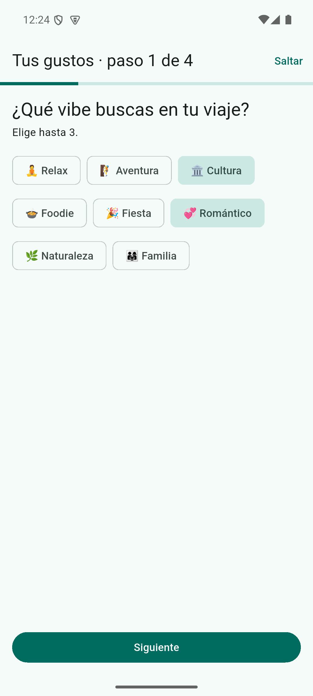
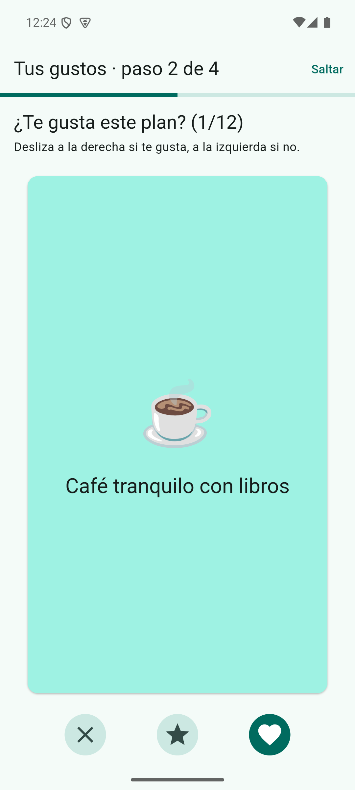
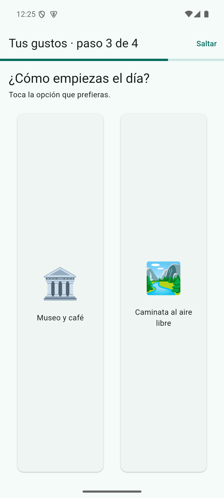
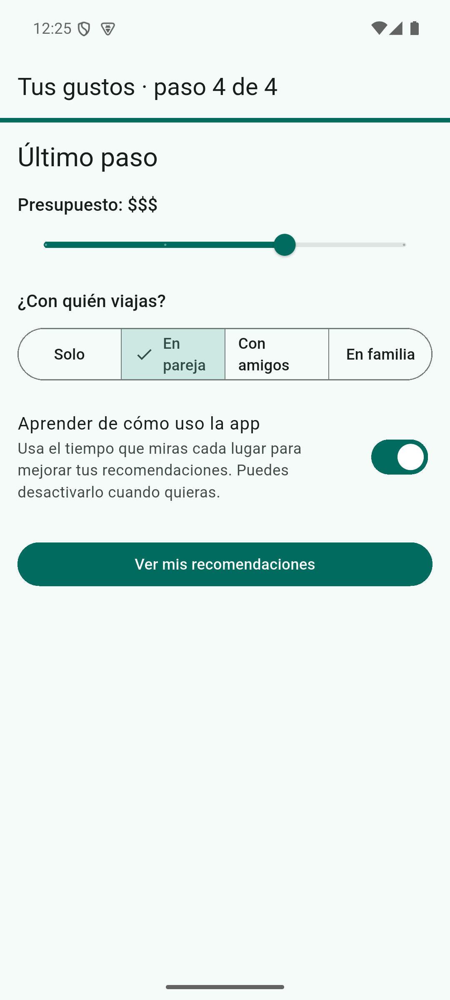
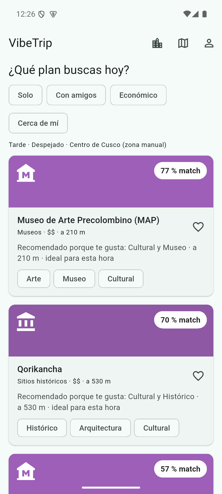
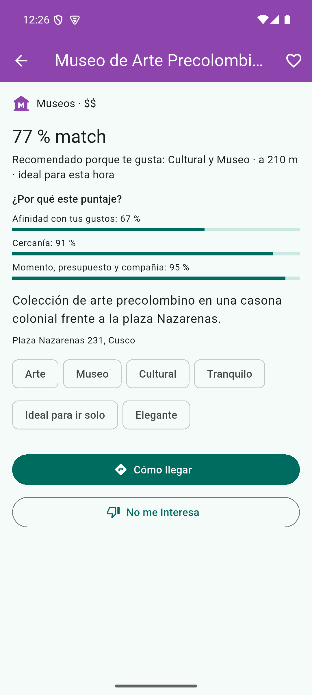
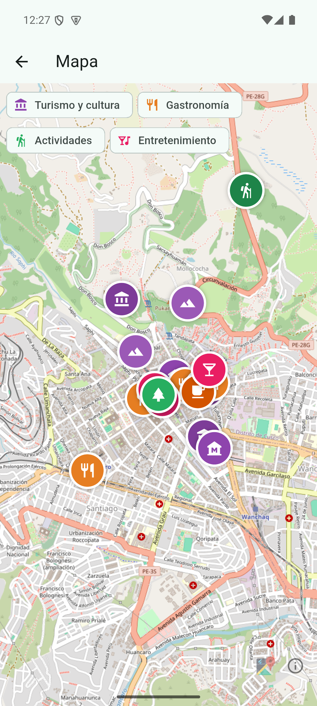
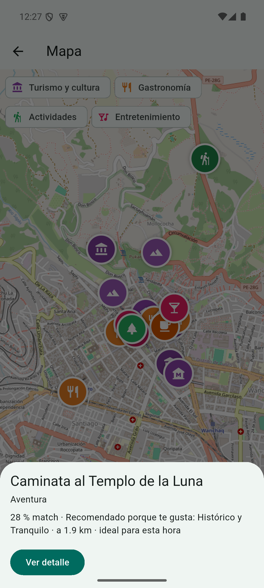
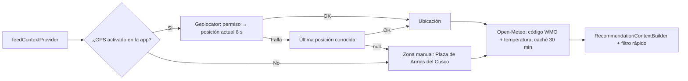

# Entregable 5: UI/UX, Geolocalización y Aseguramiento de Calidad

**Proyecto:** VibeTrip
**Trazabilidad:** HU-01 a HU-05; RF-01 a RF-17 (excepto RF-01, ver §6); RNF-01, RNF-05, RNF-09, RNF-12, RNF-13

---

## 1. Pantallas

Capturas tomadas en el emulador Android `Pixel_API_35` con el APK *release* (modo local, seed de Cusco).

| Onboarding: vibes | Onboarding: deck *swipe* | Onboarding: dilema A/B | Onboarding: ajustes |
|---|---|---|---|
|  |  |  |  |

| Feed con filtros rápidos | Detalle y desglose del puntaje | Mapa con pines por categoría | Pin seleccionado |
|---|---|---|---|
|  |  |  |  |

### 1.1 Onboarding interactivo (HU-01, RF-02, RF-03)

`lib/features/profile/presentation/onboarding_screen.dart`

| Paso | Interacción | Dato capturado |
|---|---|---|
| 1. Vibes | `FilterChip`, máximo 3 | Prior `p` |
| 2. Deck | Deslizar (`Dismissible`) o botones ✕ / ★ / ♥ | `rᵢ ∈ {−1, +2, +1}` |
| 3. Dilemas | Tocar una de dos tarjetas | Contraste `δ` |
| 4. Ajustes | `Slider` 1-4, `SegmentedButton`, `Switch` de consentimiento | Presupuesto, compañía, `telemetry_consent` |

«Saltar» está visible en los pasos 1 a 3 y guarda lo respondido hasta ese momento. El consentimiento de telemetría arranca **desactivado** (RNF-09).

### 1.2 Home Feed inteligente (HU-02, RF-06, RF-07, RF-08)

`lib/features/recommendation/presentation/feed_screen.dart`

- «¿Qué plan buscas hoy?»: `ChoiceChip` **Solo**, **Con amigos**, **Económico** (precio ≤ 2), **Cerca de mí** (radio 1 km). Al tocar el filtro activo, se desactiva.
- Línea de contexto: franja horaria · clima · origen de la ubicación.
- Tarjetas con color e ícono de la categoría, **% de match**, distancia, explicación y 3 etiquetas.
- Cada tarjeta va dentro de `UserBehaviorTracker` (dwell time, RF-04).
- *Pull-to-refresh*, aviso de «Sin conexión» al servir la caché y estado vacío con acceso a la zona manual.

### 1.3 Detalle (RF-10, RF-11, RF-12, RF-14)

Desglose «¿Por qué este puntaje?» con las tres barras (afinidad, cercanía y contexto), favorito, **Cómo llegar** (Google Maps por `url_launcher`) y **No me interesa** (lo oculta del feed al instante).

### 1.4 Mapa (RF-13)

`flutter_map` con teselas de OpenStreetMap (sin API key), pines circulares con el color y el ícono de la subcategoría, leyenda de las 4 categorías raíz, punto azul de la ubicación del usuario y hoja inferior con el match y un acceso al detalle. Incluye la atribución que exige la política de uso de OSM.

### 1.5 Perfil y privacidad (RF-16, RF-17)

Gustos aprendidos, interacciones, favoritos, interruptor de consentimiento, **exportar mis datos** (JSON copiable), **reajustar gustos** (repite el onboarding y conserva los favoritos) y **eliminar todos mis datos**.

---

## 2. Geolocalización y contexto



| Código WMO / temperatura | `WeatherCondition` |
|---|---|
| código ≥ 51 (llovizna, lluvia, nieve, tormenta) | `rain` |
| < 8 °C | `cold` |
| > 27 °C | `hot` |
| código 0-1 | `clear` |
| resto | `cloudy` |
| sin red / error | `unknown` (efecto neutro) |

> **Hallazgo durante la prueba en el emulador:** el emulador reporta por defecto Mountain View (EE. UU.), a miles de kilómetros de los lugares semilla. La app mostró el estado vacío «No encontramos lugares para este plan cerca de ti» con el botón «Explorar el Centro de Cusco». Por eso el ícono de la barra superior permite alternar entre **GPS** y **zona manual**.

---

## 3. Pruebas (QA)

| Nivel | Archivos | Casos |
|---|---|---|
| Unitarias de dominio | `test/core/**`, `test/features/**` (excepto `widget_test.dart`) | Matemática, entidades, motor, aprendizaje, onboarding, telemetría, contexto, métricas |
| Datos | `places_data_test.dart`, `profile_and_telemetry_data_test.dart`, `context_and_metrics_test.dart` | Seed, mapper, Decorator offline, cola idempotente, Open-Meteo con `MockClient` |
| Widget | `test/widget_test.dart`, `user_behavior_tracker_test.dart` | Onboarding completo y «Saltar», filtro Económico, favorito, «No me interesa», eliminar datos, tracker |
| Evaluación | `test/evaluation/recommender_evaluation_test.dart` | Precision@K y latencia |

**Resultado:** 119 pruebas en verde.

| Alcance | Cobertura de líneas |
|---|---|
| Capa de dominio (*quality gate* CI ≥ 90 %) | **99.7 %** |
| Todo `lib/` | 86.4 % |
| Capa de presentación | 75.8 % |

La pantalla de mapa no tiene prueba de widget porque descarga teselas de internet; se verificó manualmente en el emulador (capturas 07 y 08).

### 3.1 Errores encontrados y corregidos gracias a las pruebas

| Error | Cómo se detectó | Corrección |
|---|---|---|
| `UnmountedRefException` al guardar un evento después de destruir el provider | Prueba de widget «saltar onboarding» | Verificar `ref.mounted` tras cada `await` en `UserProfileController` |
| Uso de `ref` dentro de `dispose()` en el detalle | Prueba «No me interesa» | Guardar el controlador en `initState` |
| El punto de ubicación quedaba tapado por los pines | Revisión visual en el emulador | Dibujar el marcador del usuario al final |

---

## 4. Métricas para la sustentación

Reproducibles con:

```bash
flutter test test/evaluation --reporter expanded
```

### 4.1 Precision@3

Cinco perfiles sintéticos sobre los 18 lugares de Cusco. Los lugares relevantes se definen **por categoría** (por ejemplo, Fiestero → bares y discotecas), no por etiquetas, para no favorecer al motor. La línea base ordena solo por distancia.

| Perfil | P@3 híbrido | P@3 solo distancia |
|---|---|---|
| Fiestero (noche, amigos) | 0.67 | 0.67 |
| Cultural (mañana, solo) | 0.67 | 0.00 |
| Foodie económico (tarde, amigos) | 1.00 | 0.00 |
| Pareja romántica (atardecer) | 1.00 | 0.33 |
| Naturaleza y aventura (mañana) | 0.67 | 0.33 |
| **Media** | **0.80** | **0.27** |

El motor híbrido triplica la precisión de la línea base. Límite de esta evaluación: los perfiles y la relevancia los definió el equipo; para una validación externa hay que medir con usuarios reales (pendiente en el backlog).

### 4.2 Latencia (RNF-01)

Ranking de **500 candidatos sintéticos**, 100 corridas después de 5 de calentamiento:

| Percentil | Tiempo | Requisito |
|---|---|---|
| p50 | 1.8 ms | — |
| p95 | 3.6 ms | ≤ 150 ms ✅ |

Medido con `flutter test` (VM de Dart en modo JIT) en la PC de desarrollo. Falta medirlo en un celular con el *Profiler* en modo `--profile`, y registrar el resultado en `docs/perf/`.

---

## 5. Cómo ejecutar

```bash
flutter pub get
flutter run                     # modo local con el seed de Cusco
flutter test --coverage         # 119 pruebas
flutter test test/evaluation --reporter expanded   # métricas
```

Con Supabase (opcional):

```bash
flutter run --dart-define=SUPABASE_URL=https://<proyecto>.supabase.co \
            --dart-define=SUPABASE_PUBLISHABLE_KEY=<clave>
```

## 6. Pendientes conocidos (backlog)

| Pendiente | Requisito | Motivo |
|---|---|---|
| Autenticación con correo y Google | RF-01 | No hay un proyecto de Supabase configurado; la app usa un id local (UUID) |
| Sincronizar el perfil con `PUT /v1/me/preferences` | API E1 | Depende de RF-01 |
| Probar `supabase/seed_places.sql` contra una base real | E3 | Sin instancia de Supabase disponible |
| Medir latencia y fps en un dispositivo con el Profiler | RNF-01 a RNF-03 | Solo se midió en la PC |
| Prueba de usabilidad del onboarding con 5 usuarios (≤ 45 s) | RNF-04 | Requiere usuarios reales |
| Selección adaptativa de cartas (MMR) | E1 §1.2 | Se implementó un deck fijo con cobertura de 2 cartas por grupo |
| Agrupar pines cercanos en el mapa | RF-13 | En la Plaza de Armas varios pines se superponen |
